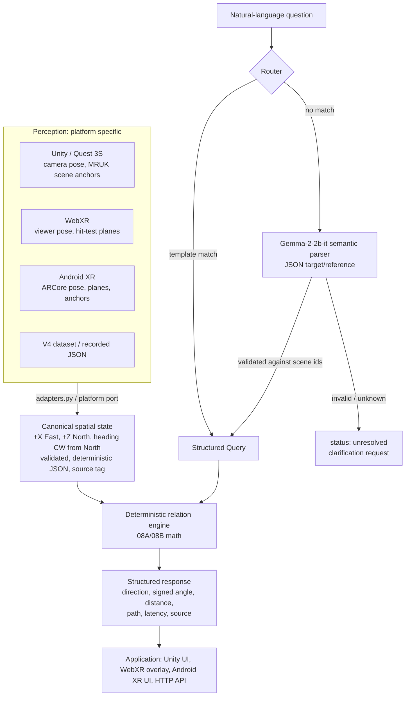

# EgoSpatial architecture

## Responsibilities
| Layer | Owns | Must never |
|---|---|---|
| Perception (platform) | Poses, anchors, planes, object labels | Compute relations itself |
| Adapters | Axis conventions, units, north offset, `source` tag (simulated / recorded / live) | Drop or invent objects |
| Canonical state | Validation (finite numbers, unique ids, non-empty) and canonical ordering | Accept ambiguous input silently |
| Deterministic engine | All geometric answers | Depend on a neural model |
| Neural parser (optional) | Question → structured query; refer to objects by description | Output a direction or distance |
| Orchestrator | Routing, validation of parser output, abstention, timing | Guess when it can't resolve the question |

## Relation semantics
| Op | Meaning | Frame |
|---|---|---|
| `object_to_agent` | Where is X relative to me? | Agent heading |
| `object_to_object` | 08B-3: displacement Y→X, seen from the agent's frame | Agent heading |
| `reference_frame` | V4 dataset: face Y, then classify X | Bearing agent→Y |
| `distance` | Horizontal (default) or 3D distance | — |

"Where is X relative to Y" is ambiguous in English. The engine's default (`object_relation="reference_frame"`) matches the V4 data. XR apps that mean "is the cup left of the plate, from where I stand" should construct `SpatialEngine(object_relation="object_to_object")`.

## Evidence trail
08C-10 → 08D-5 (behaviour) → 08D-6A (output layer) → 08D-6B/6C (hidden states) → 08D-7 (decision) → 08E (hybrid measured). All artifacts are under `hf://Platinum04/EgoSpatial-Gemma-v2/08_spatial_state_builder/`.
